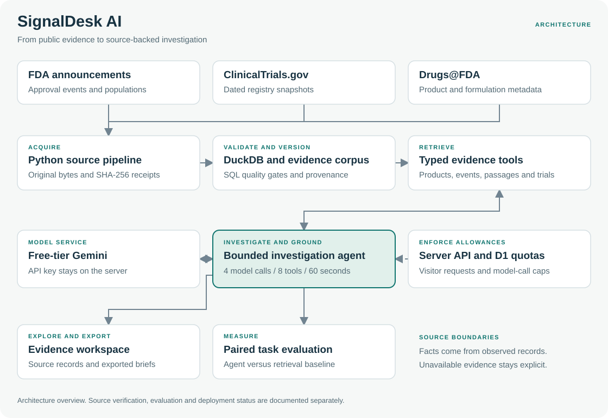

# SignalDesk AI

**Oncology competitive intelligence, connected to evidence.**

[Source repository](https://github.com/f20230125-sudo/-signaldesk-ai)

[Live prototype](https://signaldesk-ai-phi.vercel.app)

Investigate documented FDA developments, resolve product formulations, inspect the cited trials and export a source-backed commercial brief.

The initial collection contains **29 real FDA announcements, eight product formulations and 30 FDA-cited NCT identifiers**, covering January 2024–October 2026. The selected watchlist includes KEYTRUDA, OPDIVO, IMFINZI, TECENTRIQ and LIBTAYO, with separate subcutaneous formulations.

## Current validation status

The collection contains **30 acquired ClinicalTrials.gov snapshots and eight product identities matched to Drugs@FDA records**. All 29 announcement dates, trial links, populations and qualifiers have dated developer field reviews against FDA publisher pages. Saved literal proof excerpts (at most 25 words per announcement) have SHA-256 receipts. These are selective browser-text captures, not full snapshots or original HTTP HTML downloads; original HTML acquisition remains blocked. The 58 paraphrase passages remain labelled separately, and no independent clinical adjudication is claimed.

The frozen **20-development / 40-held-out** paired evaluation is complete, including recorded **Codex-assisted source-support review of all 120 responses**. On the held-out set, the agent achieved **17/40 strict successes (42.5%)**, compared with **19/40 (47.5%)** for the same-model BM25 baseline. The prespecified **34/40 target was not met**. This is a research prototype; no superiority or production-readiness claim is made. Reviews are AI-assisted, with no independent human or clinical adjudication. See [benchmark results](docs/benchmark-results.md), [failure analysis](docs/failure-analysis.md), [case-level report](data/evaluation/report.json) and [review decisions](reports/semantic-audit-held-out.json). Earlier diagnostics remain in [evaluation attempts](reports/evaluation-attempts.json).

**SignalDesk is live on Vercel with Gemini and persistent Redis quotas configured:** [open the prototype](https://signaldesk-ai-phi.vercel.app). **24 hosted browser/UI/API checks passed**, including mobile layout, evidence details, export and visitor-limit enforcement. Of five hosted investigation attempts, **two completed and three encountered Gemini free-tier quota errors**. The visitor limit remained enforced after a new deployment. These integration checks are separate from the frozen evaluation and do not establish clinical accuracy. See the [hosting guide](docs/vercel.md) and [hosted QA receipt](reports/hosted-qa.json).

Verification: **31 agent/tool/scoring/hosting tests and nine Python checks passed**, with one original-source integrity check explicitly skipped in the source-only checkout. The full framework typecheck, database migration generation, Cloudflare build and standard Next.js Vercel build passed in [GitHub Actions](https://github.com/f20230125-sudo/-signaldesk-ai/actions/runs/39057789310). The generated D1 migration is committed and exercised by the quota checks. Earlier Cloudflare production-build validation passed **18 browser/API checks**. Vercel publication, 24 hosted checks, two completed real-model investigations and Redis quota persistence are verified; Gemini provider limits prevented three additional investigations from completing. See the [validation record](docs/validation.md).

## Investigation workflow

The workspace includes labelled filters, approval-date sorting, shareable filtered views, a source-inspection drawer and a phone layout that keeps records readable. Investigations show their product scope and retain the previous completed brief if a new request fails. The evaluation view provides paired outcomes and review notes without sending full run traces in the initial page. See [design references and UI verification](docs/ui-design.md).

The redesign passed **56 production-build UI checks**, including six automated accessibility scans with no reported violations. Success and quota-error interface states use intercepted frozen-result fixtures; these are separate from live-model validation. See the [UI QA receipt](reports/ui-redesign-qa.json).

1. Filter the event feed by product, indication and approval year.
2. Open an event to inspect its approved population, evidence notes and cited trial identifiers.
3. Ask a competitive question. The model resolves products, searches events, reads evidence and requests trial records through typed tools.
4. Inspect documented facts separately from possible commercial relevance and follow-up questions.
5. Export the brief, including its sources, model identity, snapshot and limitations.

For example, the Imfinzi and Opdivo resectable NSCLC announcements identify different approval dates and supporting studies. The agent must preserve the populations and biomarker exclusions, and must not infer clinical superiority from separate trials.

## Architecture



[View full-size diagram](docs/architecture.svg) · [Editable Mermaid source](docs/architecture.mmd)

Python prepares the data. The TypeScript agent and its tools run unchanged in the evaluation runner and hosted application. Facts are hydrated from observed source records. Referenced event, passage, product and trial IDs are validated; unavailable evidence stays unavailable. Numeric claims in generated commercial interpretation and follow-up text are rejected.

The agent has at most four model calls, eight tool executions and a one-minute timeout. The public endpoint uses persistent daily request and model-call limits, origin checking and server-only credentials. There is no silent mock-model fallback.

## Run locally

For Vercel hosting, see [deployment and server-only settings](docs/vercel.md). The Vercel build uses `npm run build:vercel` with persistent Redis quotas; the original Sites build continues to use D1.

Python 3.11+ and Node 24:

```powershell
python -m pip install -e ".[test]"
python tools/acquire.py
python tools/build_corpus.py
npm ci
npm run db:generate
node --experimental-strip-types --test tests/tools.test.ts
python -m pytest -q tests/python
node tools/check-freeze.mjs
npm run dev
```

The committed reviewed corpus runs without reacquiring sources. To validate its saved publisher reviews and rebuild the DuckDB warehouse, run `python tools/apply_source_reviews.py`. To inspect the summaries without acquired provenance, use `python tools/build_corpus.py --seed-only`. This mode is clearly labelled and is not accepted for the final held-out benchmark.

Copy `.env.example` to an ignored local environment file and configure the free-tier model key. Production runtime values belong in secure hosting settings. No keys belong in Git, the browser bundle or a portfolio archive. See [runbook](docs/runbook.md).

## Evaluation

The benchmark is developer-authored and source-reviewed, with no independent clinical adjudication. Events sharing a supporting trial stay in the same split. The task file and seed have frozen hashes, checked by CI.

The agent is compared with BM25 retrieval plus a single response using the same model and corpus. Results record exact event selection, product identity, trial links, evidence coverage, semantic audit, latency and usage. Automatic field checks and source-quote existence are not general answer accuracy. Strict scores require a recorded semantic audit of every answer.

See [evaluation method](docs/evaluation.md), [frozen task manifest](data/evaluation/freeze.json) and [current report](data/evaluation/report.json).

## Sources and boundaries

- [FDA oncology approval notifications](https://www.fda.gov/drugs/resources-information-approved-drugs/oncology-cancerhematologic-malignancies-approval-notifications)
- [ClinicalTrials.gov API](https://clinicaltrials.gov/data-api/api)
- [Drugs@FDA API](https://open.fda.gov/apis/drug/drugsfda/)

This is a selected announcement collection, not a complete approval history. An event date and a current trial snapshot are different observations. FDA and Drugs@FDA are related sources, not independent corroborators. US events do not establish UAE authorization. Possible business relevance is a hypothesis for review, not measured commercial impact.

Independent portfolio work using public evidence. No MSD affiliation or internal data is claimed.
